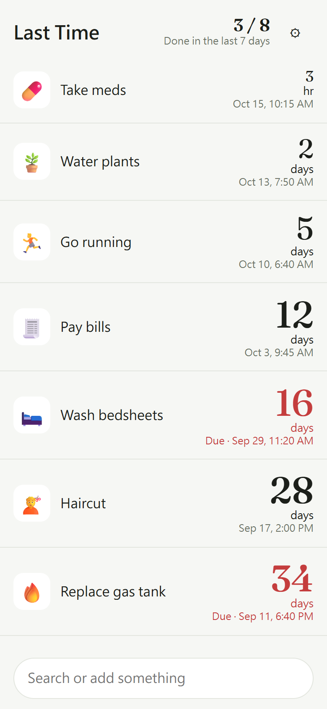
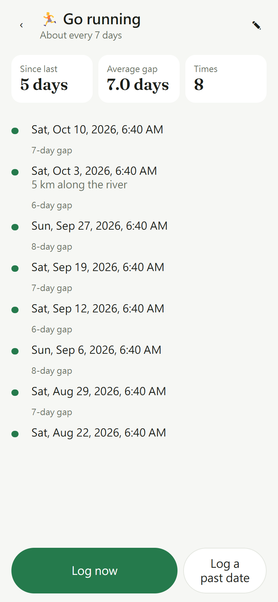
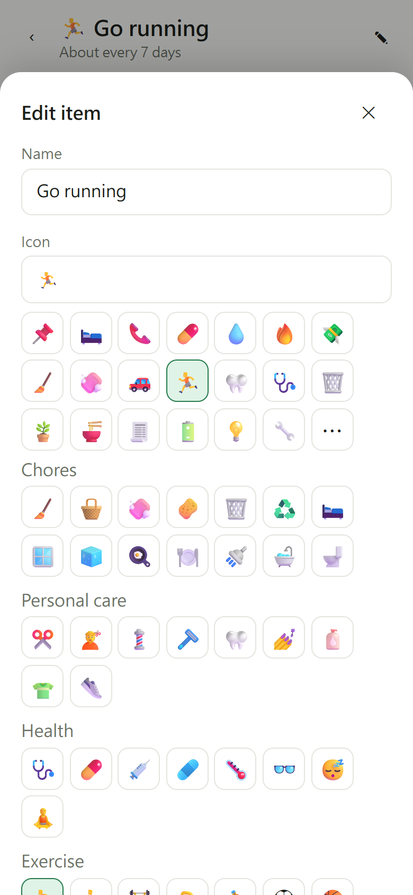

# Last Time

English | [繁體中文](README.zh-TW.md)

**Last Time** tracks how many days it has been since you last did something: take meds, change the water filter, call your parents. Press and hold an item to log it; undo is one tap away.

Website: https://cyril1018.github.io/last-time/

No account, no server, no ads. Your data stays in your phone's browser. The interface is in English or Traditional Chinese, following your phone's language; you can change it in Settings.

<p>
  
  
  
</p>

## Install on Android (Chrome)

1. Open the website in Chrome.
2. Menu → "Add to Home screen" or "Install app".
3. It then opens from your home screen and works offline.

Press and hold the home screen icon for an "Add item" shortcut.

## Backup and restore

- Settings → "Export backup" downloads `last-time-backup-YYYY-MM-DD.json`. "Share backup" (where supported) sends it straight to cloud storage or a chat app.
- On a new phone: Settings → "Import backup" → pick the file → "Replace current data".
- "Merge into current data" only adds items and entries you don't have yet, so importing twice never duplicates anything.

## Where your data lives

Data is stored in the browser's IndexedDB and localStorage. These erase it, so export a backup first:

- Clearing Chrome's site data or this site's storage
- Uninstalling Chrome
- The phone running very low on storage, for a site not added to the home screen

Updating the site only replaces the app, never your data.

## Development

```bash
npm install
npm run dev        # http://localhost:5173/last-time/
npm test           # Vitest
npm run check      # svelte-check
npm run build      # outputs to dist/
```

Pushing to `main` makes GitHub Actions test, build and deploy to GitHub Pages.

## License

Code: MIT. The [Fraunces](https://github.com/undercasetype/Fraunces) font ships with the site under the SIL Open Font License 1.1; the full text is in `src/assets/fonts/OFL.txt`.
